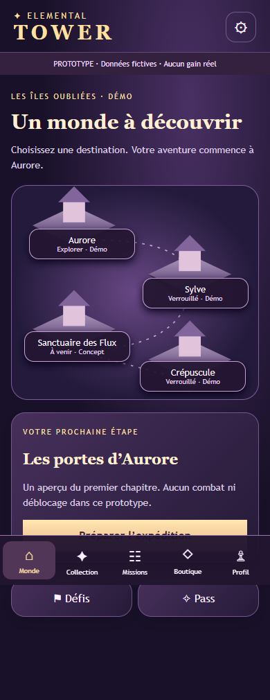
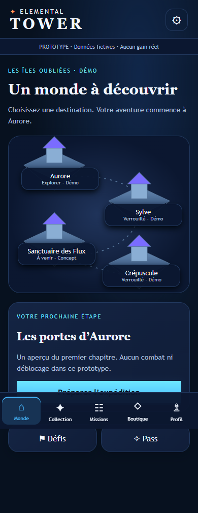

# DA-01 — Palette bleu nuit

Statut : proposition artistique à valider. Branche `feature/da-01-night-palette`, issue de META-03 (`812d579`). Aucune structure de dashboard copiée.

## Changement

Modification de `meta/shell.css` uniquement pour le produit : fond #07111F, fond secondaire #0B1730, surfaces #101D38, bordures #22395F, texte #F2F7FF et secondaire #A9BEDA. Actions et sélection bleu #46B8FF / cyan #6EE7FF, accents violet #7A6CFF / #B06CFF, orange #FF9A5A ponctuel sur l’étoile de marque et les titres d’objectif. Ombre lumineuse très faible sur l’action principale ; pas de halo animé.

Carte SVG existante recolorée par CSS : les chemins et positions ne changent pas. Typographie fantasy, portraits et leurs couleurs propres, contenus, tailles tactiles, espacements, structure, safe areas et préférences de mouvement conservés. L’ancien jeton `--gold` devient un alias couleur bleu pour les sélecteurs hérités.

L’image de référence n’est pas jointe au message accessible dans ce chat. La palette textuelle fournie est donc la seule référence appliquée. Aucune fidélité à une image non consultée n’est revendiquée.

Aucun changement de gameplay, GameBridge, catalogue, progression ou sauvegarde. Aucun fichier de test existant modifié. Ajout d’un script autonome de comparaison visuelle : `tests/palette-review.mjs`.

## Preuves avant/après

`node tests/palette-review.mjs` compare la feuille CSS du commit META-03 `812d579` avec la feuille courante, sur la même application et les mêmes données. Chaque mode utilise une page neuve, sans progression enregistrée. La feuille historique est servie au navigateur uniquement par interception de test, sans modification du produit.

11 écrans × 3 largeurs (320/390/430, hauteur 844) × 2 palettes = **66 captures** : Monde, Collection, fiche Nyx, Missions, Boutique, Profil, Paramètres, Pass, Préparation, connecteur de démonstration et Résultats victoire. Elles sont produites dans `test-results/da-01/`.

Les captures 390 px de Monde, Collection, Profil et Résultats avant/après sont jointes dans `docs/screenshots/da-01/`. L’archive de livraison contient l’ensemble des 66 captures et `validation.json`.

Exemple Monde :

| Avant | Après |
| --- | --- |
|  |  |

## Vérifications réussies

- `npm test` : 14 tests unitaires existants réussis.
- `npm run test:ui` : suites META-01/02/03 réussies à 320, 390 et 430 px, sans erreur JavaScript observée.
- Comparaison géométrique avant/après des en-têtes, bandeau, contenu, navigation, titres, paragraphes, liens, boutons et cartes sur les 11 écrans aux trois largeurs : coordonnées et dimensions identiques.
- Aucun débordement horizontal observé sur ces écrans ; stockage local inchangé entre l’entrée et le résultat de la démonstration.
- Contrastes calculés sur les paires de texte de palette : principal/surface 15,56:1 ; secondaire/surface 8,82:1 ; bleu/surface 7,62:1 ; cyan/surface 11,58:1 ; orange/surface 7,99:1 ; texte sombre sur les deux extrémités du dégradé d’action 8,62:1 et 13,11:1. Ces mesures ne constituent pas un audit exhaustif WCAG (états désactivés, bordures, tous les effets et lecteurs d’écran non audités).
- Capture Monde après en 390 px inspectée visuellement : bleu nuit dominant, cartes marine, accents colorés localisés et navigation conservée. Les captures pleine page incluent la navigation fixe ; le contenu long reste accessible par défilement.

## Validations humaines nécessaires

- Approuver le niveau de bleu, la saturation cyan/violet, l’usage ponctuel d’orange et l’intensité des effets subtils.
- Confirmer l’accord entre la nouvelle interface et les futurs portraits/illustrations canoniques. Les silhouettes provisoires conservent leurs couleurs antérieures ; aucun asset définitif n’a été recoloré.
- Comparer à l’image de référence si elle est rendue disponible, uniquement pour l’ambiance couleur, sans reproduire sa structure.
- Vérifier sur téléphones réels OLED/LCD, faible luminosité, Safari/iOS et Android : les captures Edge headless ne valident pas le rendu physique des noirs, la fatigue visuelle ni toutes les situations d’accessibilité.

Aucune fusion ni aucun déploiement. La palette est une proposition DA-01, pas une direction artistique définitivement validée.
