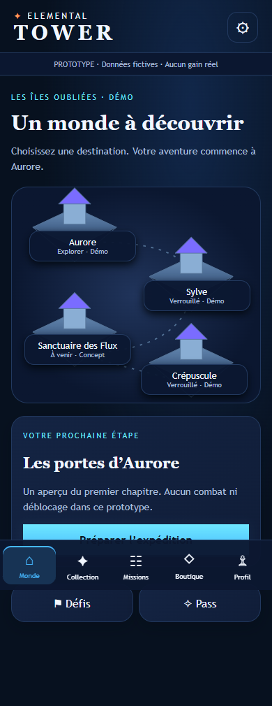
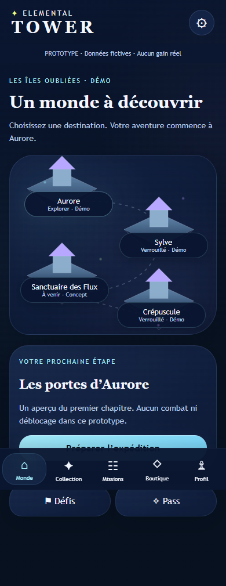

# DA-02 — Fantasy nocturne adoucie

**Proposition visuelle à valider.** Branche `feature/da-02-soft-fantasy`, issue de DA-01 (`2346dcf`). Seul fichier produit modifié : `meta/shell.css`. Aucun changement de structure générale, contenu, gameplay, GameBridge, catalogue ou sauvegarde ; tests existants conservés.

## Choix visuels

- **Rondeur** : cartes 28–38 px avec angles légèrement asymétriques ; carte du monde 34–48 px ; boutons et CTA capsule ; filtres 24 px, modales et états vides 36 px. Grilles, tailles tactiles, positions, espacements et parcours restent identiques.
- **Halos** : gradients radiaux très diffus cyan/lilas à faible opacité derrière le monde et certaines surfaces. Quelques points de lumière statiques évoquent un monde vivant. Aucune animation lumineuse ajoutée ; effets non bloquants et sans capture des interactions.
- **Saturation** : cyan pastel #7DDCFF / #A6F0FF sur les CTA, lilas #B8A7FF et rose #E49CFF en touches secondaires ; vert #B7FFB0 et jaune #E8FF8A ponctuels. Retrait du bleu électrique et de l’orange de DA-01 comme accents actifs. Texte #F3F7FF / #B8C7E6.
- **Répartition 80/20** : les fonds et cartes restent #07111F, #0A1630, #0E1B38 et #132345. Le pastel sert d’accent, pas de grande surface. Mesure indicative des 33 captures finales : **89,1 à 94,9 % de pixels bleu profond** (B>R, B≥G, canal maximal≤110). Cette heuristique n’est pas une mesure perceptuelle exacte : la proposition est volontairement plus retenue qu’un 80/20 littéral. Valider humainement si davantage de lumière est souhaité.
- **Fantasy douce** : contours souples, séparations atténuées, toits lilas et lumières bioluminescentes discrètes ; typographie fantasy et portraits provisoires conservés. Aucun layout de dashboard de référence repris.

## Captures et tests

Comparaison contre la feuille DA-01 du commit `2346dcf`, sur les mêmes contenus et états. `node tests/soft-fantasy-review.mjs` produit **66 captures** : 11 écrans × 320/390/430 px × avant/après (Monde, Collection, fiche Nyx, Missions, Boutique, Profil, Paramètres, Pass, Préparation, connecteur et Résultats). Hauteur de viewport : 844 px ; captures pleine page.

Exemples des sept écrans demandés à 390 px dans `docs/screenshots/da-02/`. L’archive de livraison inclut les 66 captures et les mesures. Les cartes Monde et Collection après ont été inspectées visuellement à 390 px.

| Avant DA-01 | Après DA-02 |
| --- | --- |
|  |  |

- 14 tests unitaires réussis ; suites navigateur META-01/02/03 réussies aux trois largeurs.
- Comparaison des positions/dimensions des principaux éléments sur les 11 écrans : identiques. Aucun débordement horizontal ou erreur JavaScript observé ; stockage inchangé sur le parcours de démonstration.
- Paires texte/fond et texte sombre/CTA testées ≥4,5:1 de contraste. Cette vérification ne remplace pas un audit complet d’accessibilité, notamment états désactivés et rendu physique.

## Validation humaine restante

Approuver la rondeur, l’intensité des halos, le dosage pastel et le caractère suffisamment onirique. Confirmer si la dominance nocturne mesurée (plus de 80 %) convient. Les îles et silhouettes restent provisoires : la palette seule ne constitue pas une illustration finale du monde ni des créatures. Revoir l’accord avec les futurs assets canoniques et le mapping du collègue. Vérifier OLED/LCD, faible luminosité, iOS/Safari et Android réels ; aucune validation sur téléphone physique effectuée ici.

Aucune fusion ni aucun déploiement.
