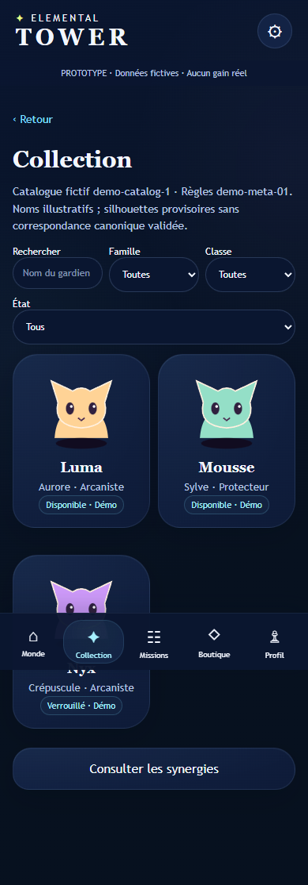
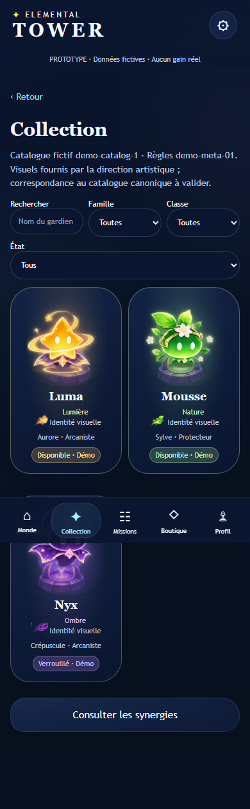

# DA-03 — Personnages fournis et magie pastel

**Passe de présentation à valider.** Branche `feature/da-03-guardian-art`, issue de DA-02 (`9f6070b`). Structure générale et navigation conservées ; agrandissement local des portraits et ajout de références artistiques dans les fiches. Aucun changement du gameplay, GameBridge, sauvegardes, IDs, conditions de déblocage ou données du catalogue.

## Réinjection des vrais visuels

Les six PNG fournis sont copiés **sans transformation** dans `meta/art/sources/`. Provenance, noms originaux, dimensions et SHA-256 : `meta/art/provenance.json`. Aucun personnage généré ou redessiné. Les planches restent des originaux RGBA 1122 × 1402 ; des fenêtres SVG avec clipping explicite isolent les cellules à l’affichage sans modifier les pixels source.

Correspondance de présentation, par nom uniquement :

| Entrée démo existante | Référence affichée | Identité colorée proposée |
| --- | --- | --- |
| demo-luma / Luma | Image #4, Luma en pose neutre | Lumière, or pastel et lilas |
| demo-mousse / Mousse | Image #4, Mousse en pose neutre | Nature, vert lumineux et fleurs pastel |
| demo-nyx / Nyx | Image #4, Nyx en pose neutre | Ombre, violet et rose lilas |

Les anciens petits personnages SVG ne sont plus utilisés pour ces trois entrées. Les autres personnages fournis restent disponibles dans les sources mais ne sont pas ajoutés au roster : leur raccordement nécessite le catalogue du collègue. La planche secondaire comporte notamment une autre apparence de Raïka que la planche de rangs ; aucune équivalence n’a été inventée.

Les portraits sont centrés sur une carte marine, entourés d’un halo local et d’un piédestal de l’image #6. Bordures et badges de collection prennent une teinte de contenu. Les fiches utilisent un grand portrait, les projectiles de l’image #5 et les effets de zone de l’image #1. Le codex présente ces mêmes FX comme références visuelles Lumière/Nature/Ombre. Les associations ne sont pas des compétences ou synergies canoniques.

Une section dépliable de fiche montre les cinq évolutions illustrées de Luma/Mousse tirées de l’image #3. Nyx montre ses poses attaque/capacité de l’image #4 : elles ne sont pas étiquetées comme des rangs. Aucun aperçu ne modifie un rang, une sauvegarde ou une statistique.

## Couleurs et équilibre

Les fonds de l’application restent ceux de DA-02. Le coloré supplémentaire est porté par les vrais personnages, icônes de projectile, FX, piédestaux et halos locaux. Pas d’arc-en-ciel de fond ni de nouvelle animation. Les gardiens verrouillés gardent leur portrait coloré avec un statut textuel explicite.

Mesure indicative sur les captures finales : **84,6 à 93,4 % de pixels bleu profond**, selon écran et largeur. Heuristique RGB, pas une mesure perceptuelle exacte ; le texte, les personnages et les FX sont hors de cette classe. Le résultat garde une dominante nocturne supérieure à 80 %, avec davantage de couleur dans le contenu.

## Validation et captures

- `npm test` : **16 tests réussis**, dont les 14 existants, plus provenance/intégrité des six PNG, alpha, correspondances nommées et validité des fenêtres de cadrage. Les clés d’art inconnues reviennent au repli, y compris les noms hérités des objets JavaScript.
- `npm run test:ui` : suites META-01/02/03 réussies à **320/390/430 px**, sans erreur JavaScript observée. Aucun test existant supprimé ou modifié.
- `node tests/guardian-art-review.mjs` : chargement des vrais assets, débordement horizontal, fiches/codex, références dépliées et sauvegarde inchangée ; test d’indisponibilité de la planche de personnages avec repli pour les trois cartes, aux trois largeurs.
- **39 captures** : avant/après Collection, Luma, Mousse, Nyx et Codex, plus les trois sections de références dépliées après, aux trois largeurs (viewport 844 px de haut). Les vues dépliées sont nouvelles et n’ont donc pas d’équivalent avant.
- Comparaison avant via app.js et CSS du commit DA-02, sur le même catalogue et sans progression enregistrée. Les fenêtres ont été corrigées après inspection pour éliminer les fragments de cellules voisines et les bandes hors cadre. Collection, fiche Mousse et codex 390 px inspectés visuellement après correction.
- Exemples 390 px dans `docs/screenshots/da-03/`, ensemble régénérable dans `test-results/da-03/`. Capture pleine page : la barre de navigation fixe peut recouvrir ponctuellement une zone au point de capture ; le contenu reste défilable.

| Avant | Après |
| --- | --- |
|  |  |

## Points à valider humainement

Saturation des verts/or/violets des sources, intensité des halos et piédestaux, cadrage et taille des personnages, lisibilité du statut verrouillé, accord UI sombre/contenu lumineux. Les sources ne sont pas désaturées ni recolorées artificiellement : elles conservent les couleurs fournies.

Confirmer avec le collègue le mapping des visuels vers ses IDs, éléments, familles, compétences et évolutions ; les noms et éléments visuels ne remplacent pas son catalogue. Les descriptions et conditions existantes restent des fixtures de démonstration. Les autres gardiens fournis seront raccordés après validation, sans les inventer ou les substituer.

Performances et rendu physique à vérifier sur iOS/Android, Safari, OLED/LCD et faible luminosité. Les six planches originales totalisent environ 17 Mo et sont partagées/cachées par le navigateur ; cette livraison privilégie la fidélité des sources, pas une optimisation de build mobile. Des exports individuels optimisés sont à préparer ultérieurement après validation des cadrages. Aucun test sur téléphone physique effectué ici.

Aucune fusion ni aucun déploiement.
