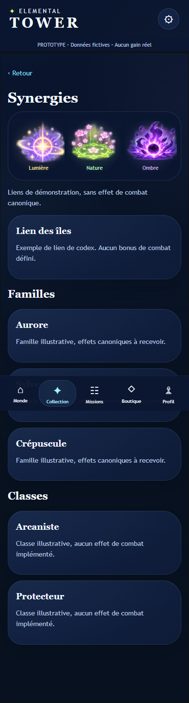
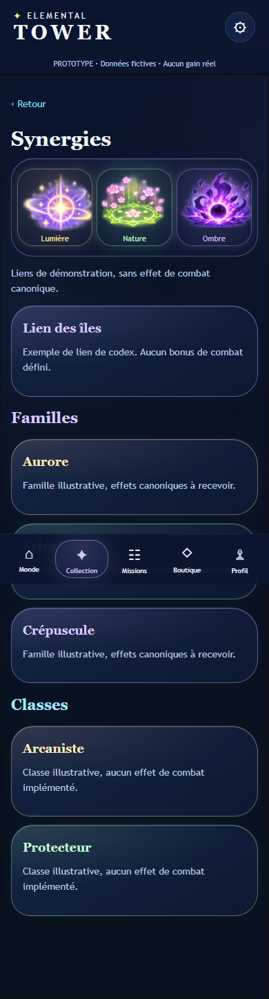

# DA-04 — Redistribution de la couleur dans l’interface

**Proposition artistique à valider.** Branche `feature/da-04-ui-color`, issue de DA-03 (`36da594`). Seul fichier produit modifié : `meta/shell.css`. Structure, personnages, catalogue, gameplay, GameBridge et sauvegardes inchangés. Aucun test existant modifié.

## Redistribution

- **Cartes/panneaux** : bordures pastel plus lisibles, petit reflet intérieur et fond marine légèrement teinté. Les panneaux alternent cyan, lilas et menthe ; pas de grande surface lumineuse ni de nouveau fond global.
- **Collection** : bordures et halo du panneau renforcés selon l’identité visuelle du gardien ; noms, rappels d’élément et capsules de statut plus colorés. Portraits fournis conservés intégralement. Les statuts restent écrits, la couleur ne remplace pas leur sens.
- **Filtres** : recherche/état cyan, famille lavande, classe menthe ; fond teinté, sélection persistante plus claire, focus clavier explicite avec halo doux. Aucune modification de logique de filtre.
- **Codex** : vignettes FX encadrées et teintées ; Lien des îles, Familles et Classes reçoivent des titres et bordures lilas/ambre doux/menthe. Ces couleurs de panneaux sont **décoratives**, distribuées selon l’ordre de présentation ; elles n’ajoutent pas de famille, effet ou règle de jeu.
- **Navigation** : seule la capsule active reçoit un accent propre à sa rubrique (cyan, lavande, menthe, rose ou ambre). Les onglets inactifs et la barre restent bleu nuit ; aucun effet animé ajouté.

La répartition **80/20 est une intention perceptuelle**, pas une contrainte exacte de pixels. Les grandes surfaces restent bleu nuit. Mesure indicative sur les 39 vues finales : **88,4–94,3 % bleu profond** (RGB à dominante bleue, canal maximal ≤110). Les teintes sombres peuvent rester comptées comme bleu profond : cette mesure confirme la dominance nocturne, elle ne mesure pas à elle seule la richesse colorée perçue.

## Tests et captures

- `npm test` : **16 tests réussis**, incluant provenance des assets et tests de progression/contrat existants.
- `npm run test:ui` : suites META-01/02/03 réussies à **320/390/430 px**, sans erreur JavaScript observée.
- `node tests/ui-color-review.mjs` : **78 captures** DA-03/DA-04 — 13 états × trois largeurs × avant/après, viewport 844 px de haut. Monde, Collection, filtre sélectionné/focalisé, fiche Nyx, Missions, Boutique, Profil, Paramètres, Pass, Synergies, Préparation, connecteur et Résultats.
- Comparaison des positions/dimensions des principaux éléments : identiques ; pas de débordement horizontal observé et stockage local inchangé.
- Paires de couleurs texte/fond héritées de la palette vérifiées ≥4,5:1 ; pas d’audit exhaustif de tous les gradients, transparences et états désactivés. Les contrastes et le dosage perceptuel restent à examiner en situation.
- Collection et Codex 390 px inspectés visuellement. Exemples avant/après dans `docs/screenshots/da-04/` ; ensemble régénérable sous `test-results/da-04/`. Capture pleine page avec navigation fixe, contenu long accessible par défilement.

| Codex avant | Codex après |
| --- | --- |
|  |  |

## Validation humaine

Valider la saturation des bordures/teintes, le niveau du glow actif, la distinction visuelle sélection/focus, la lisibilité des petits badges et la cohérence fantasy magique entre panneaux et assets. Confirmer que la redistribution paraît assez colorée tout en restant nocturne, sans forcer un ratio numérique au détriment de la lecture. Tester appareils OLED/LCD, faible luminosité, Safari/iOS et Android physiques ; aucun essai téléphone réel effectué ici.

Aucune fusion ni aucun déploiement.
