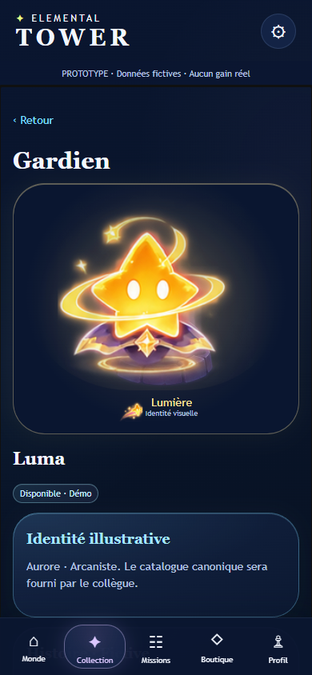
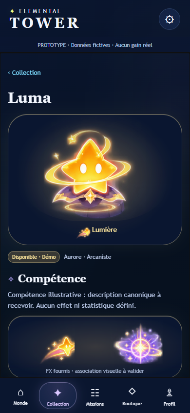

# UX-01 — Des écrans de jeu plus lisibles

**Statut : proposition UX de développement, à valider.** Branche `feature/ux-01-game-interface`, créée depuis `feature/da-04-ui-color`, commit `66814ef` de la PR #13. PR Draft empilée sur cette branche ; aucune fusion ni aucun déploiement.

## Améliorations

### Fiche gardien

Le titre principal et le titre de page portent maintenant le nom du gardien. Le portrait et l’élément ouvrent la fiche, suivis du statut disponible/verrouillé et de la famille/classe. La compétence et sa planche FX forment une section courte ; la condition de déblocage est mise en évidence. Les aperçus d’évolutions/poses existants restent dépliables, et l’histoire/les liens du codex passent dans un panneau secondaire. Aucun texte de compétence ou règle n’est inventé : les descriptions existantes restent des données de démonstration.

### Collection et codex

La collection affiche le compte de gardiens disponibles, des cartes plus compactes, un nom/élément mieux hiérarchisé et une invitation explicite vers la fiche ou le déblocage. Les gardiens verrouillés conservent leurs visuels colorés mais se distinguent par le statut, un repère et une bordure pointillée ; ils restent consultables.

Le codex remplace les grandes cartes purement textuelles par des entrées illustrées : les gardiens associés sont calculés depuis les liens/familles/classes déjà présents dans le catalogue. Leurs miniatures ouvrent leur fiche. Les descriptions se déplient à la demande. Aucune association d’asset, famille, classe ou synergie n’a été changée.

### Navigation et défilement

L’application utilise désormais un contenu central défilant entre l’en-tête et la navigation basse. La navigation occupe sa propre ligne et ne se superpose plus au contenu. Les zones de sécurité sont conservées. Les retours indiquent leur destination (Collection, Monde, Profil, etc.) et les sous-écrans gardent l’onglet principal actif cohérent. La navigation vers une nouvelle vue réinitialise le défilement du contenu.

Les retours visibles suivent un parent logique explicite ; l’historique navigateur conserve ses propres étapes, y compris le comportement d’abandon de session existant. Les panneaux ouverts et le focus des champs/boutons identifiables sont conservés lors d’un nouveau rendu dans la même vue. Les échecs d’enregistrement restent visibles ; aucune modification du dépôt de sauvegarde n’est nécessaire.

### Mode démonstration

Le bandeau « PROTOTYPE · Données fictives · Aucun gain réel » reste visible pendant le défilement. Le Profil affiche une progression explicitement fictive et un carnet de chapitres en lecture. Les scénarios de session, validations manuelles d’objectifs, diagnostics catalogue, versions et commandes de sauvegarde sont regroupés dans **Démonstration et outils QA**, accessible depuis Profil/Paramètres et la préparation. Les contrôles utilisent exactement les méthodes existantes.

La préparation valorise les portraits des gardiens admissibles et conserve le lancement clairement fictif. Le résultat privilégie vagues/durée fictives et prochain objectif ; identifiant/version de session se consultent dans les outils QA. Aucun résultat fictif n’accorde de progression permanente.

## Frontières préservées

- Aucun changement de `meta/bridge.js`, `meta/expedition.js`, `meta/progression.js`, du catalogue JSON, des fichiers d’art, de leurs coordonnées ou associations.
- Les renderers sont regroupés dans `meta/views.js`, sans import du moteur ou du stockage et sans mutation de l’état fourni. Les gestionnaires existants de session et de sauvegarde sont conservés dans l’application.
- Palette bleu nuit, rondeurs, éléments pastel et personnages issus des références DA-03 préservés. Aucun nouvel asset, compétence, règle, devise ou service.

## Tests et preuves

- `npm test` : **18 tests réussis** : les 16 existants (dont intégrité des assets) et deux tests de présentation sur données gelées/échappement de texte externe.
- `npm run test:ui` : suites META-01/02/03 conservées et adaptées aux déplacements intentionnels de contrôles et au nom H1 de fiche. Les mêmes scénarios victoire/défaite/abandon, erreurs/reprise, sauvegarde/migration et absence de progression après victoire fictive restent vérifiés.
- Nouveaux contrôles UX à **320/390/430 × 844 px**, puis **320 × 568 px** : titre unique du gardien, panneaux natifs au clavier, liens Codex → Fiche → Collection, statuts disponibles/verrouillés, position stable de la navigation pendant le défilement, réinitialisation du défilement et stockage inchangé après consultation.
- Sur 12 vues, chaque lien, bouton, champ, select et résumé de panneau **visible** est amené dans la zone centrale ; sa boîte reste hors de la navigation, et un test de pointage au centre confirme l’absence d’interception. Les contenus des panneaux sont révélés par leurs résumés accessibles ; les aperçus d’évolution et liens bas sont testés après ouverture/défilement. Pas de débordement horizontal ni erreur JavaScript observée.
- `node tests/ux-review.mjs` : **63 captures** DA-04/UX-01 aux trois largeurs : huit vues principales avant/après, positions basses de la fiche Luma dépliée et du codex, puis la nouvelle vue QA après. Captures **du viewport**, pas une longue image avec navigation superposée.
- Fiche Luma, Collection et Codex 390 px inspectés visuellement. Exemples dans `docs/screenshots/ux-01/`, ensemble régénérable sous `test-results/ux-01/`.

| Fiche avant | Fiche après |
| --- | --- |
|  |  |

## À valider humainement

Hiérarchie et densité des fiches, accès aux évolutions et aux descriptions, compréhension des gardiens verrouillés et du statut démo, repérage des outils QA, lisibilité des petites légendes. Les tailles/répartitions sont proposées, pas considérées comme définitives.

Essais tactiles sur téléphones physiques iOS/Android, Safari, encoches réelles, clavier virtuel, zoom/texte agrandi et lecteur d’écran restent nécessaires. La zone de défilement interne et le focus doivent être évalués sur ces appareils ; les tests Edge headless ne remplacent pas une revue d’accessibilité ou un test utilisateur. Les associations canoniques et les contenus de compétences restent à valider avec le collègue ; aucun arbitrage de gameplay n’a été pris.

Démarrage : `npm ci`, `npm start`, puis http://127.0.0.1:4173/meta/index.html. Les tests navigateur lancent leur propre serveur : libérer le port 4173 avant de les exécuter. Le script `ux-review.mjs` est la comparaison de cette passe ; les scripts DA antérieurs restent des outils historiques de leurs mises en page respectives.
